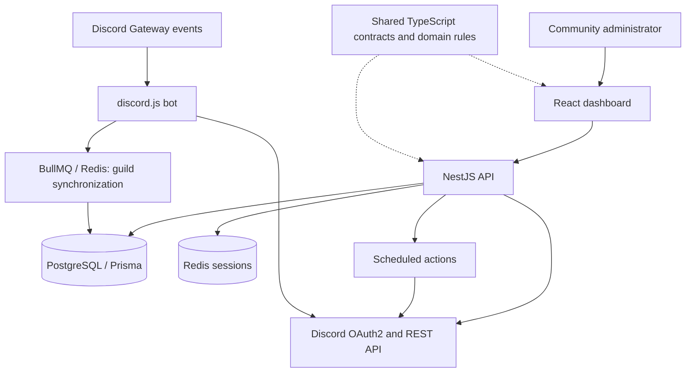

# Architecture overview

Fujini uses a TypeScript monorepo with separate web, API and bot applications. The following diagram shows component responsibilities at a high level; it omits implementation details and deployment topology.

## Boundaries

| Component | Responsibility |
| --- | --- |
| Dashboard | Editing content, configuring automation, displaying server state and scheduled activity |
| API | Authentication, authorization, validation, persistence and Discord REST operations |
| Bot | Gateway event handling, commands and event-driven automation |
| PostgreSQL | Durable server configuration, drafts, scheduling records and related product data |
| Redis | Server-side sessions, temporary OAuth state and queue infrastructure |
| Shared packages | Common contracts and reusable access/subscription rules |

## Authentication and authorization

Discord OAuth2 establishes identity. A one-time OAuth state is checked during callback handling and the session is regenerated after sign-in. Sessions are stored in Redis. Access to a server is evaluated separately using current Discord membership, roles and explicit application grants. Requests that change application state from the browser are checked against the configured origin.

These are implementation choices, not a claim of an independent security audit.

## Publishing and scheduling

Drafts contain editable message content and language variants. Delivery configuration selects channels and timing. The API executes Discord operations and persists delivery outcomes. A backend scheduler processes due actions, including scheduled posts and branding changes; BullMQ handles guild synchronization rather than all scheduling work.

## Event processing

The bot handles Discord Gateway events and routes them to automation modules. Guild synchronization uses queued jobs with retries and periodic reconciliation to bring stored server state back into alignment after missed events.

## Scope

This overview intentionally stays at the component level. Internal algorithms, database definitions and operational configuration remain in the private product repository. A production release still requires deployment preparation and further end-to-end validation.
