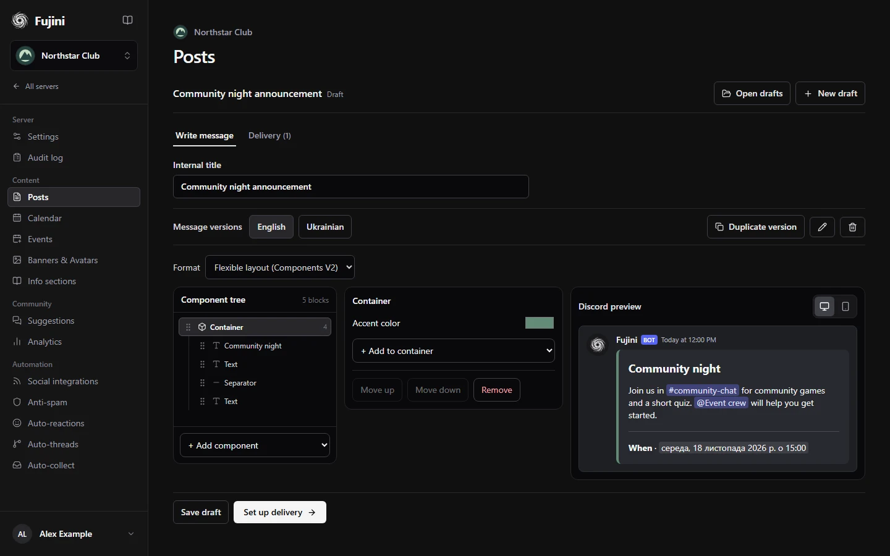
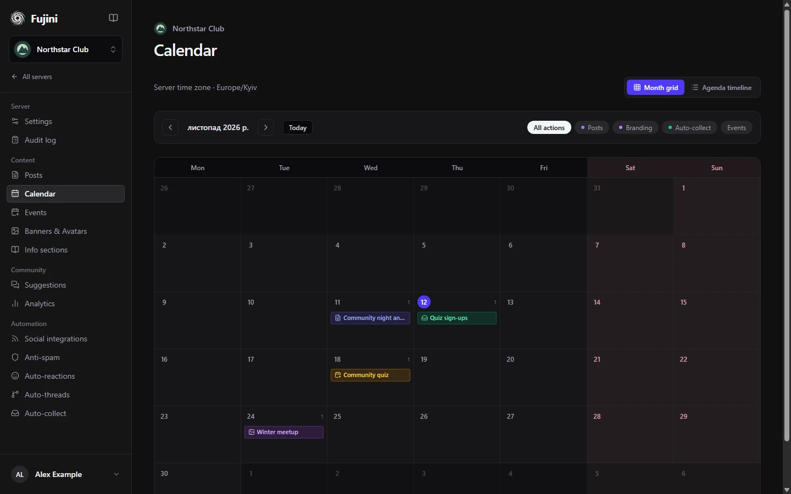
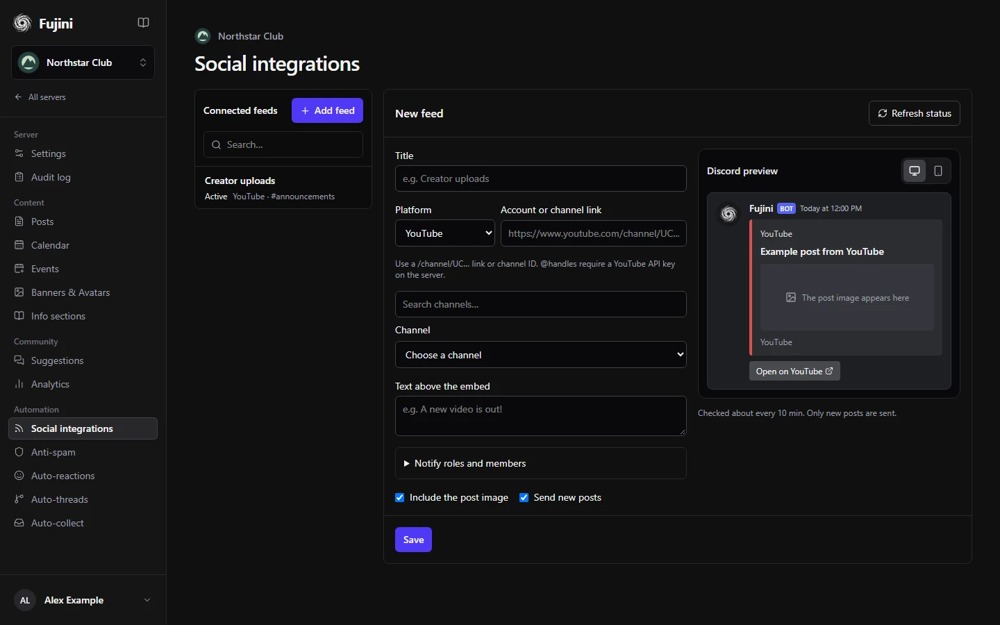
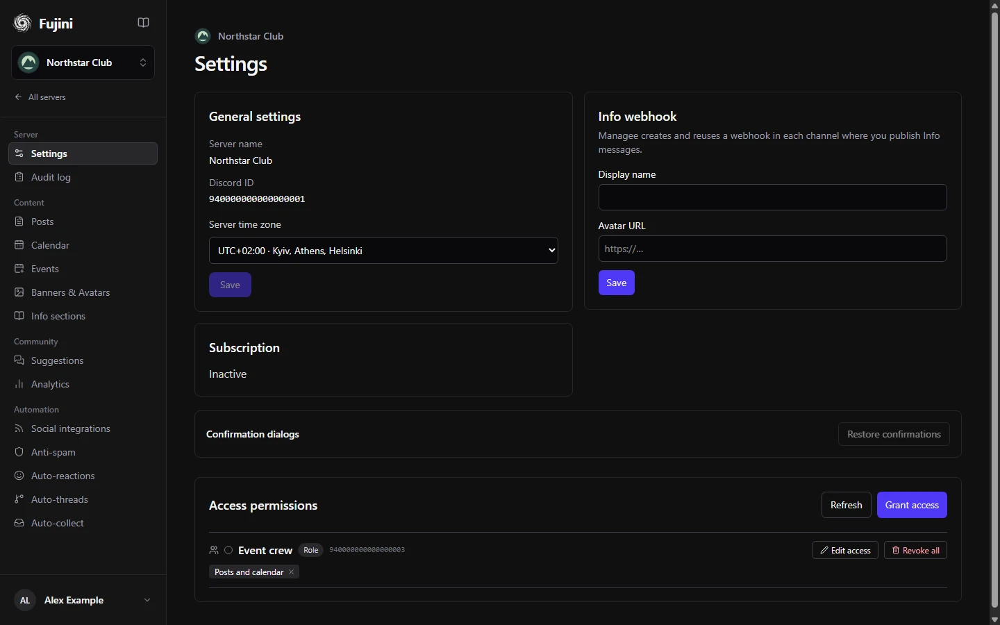

# Fujini

**Discord community management, from one dashboard.**

Fujini combines a Discord bot with a web dashboard for managing content, schedules and server automation across multiple communities. It is a personal product in active development.

**Developer:** [Valerii Okhmak](https://github.com/DONAT1N) · **Focus:** full-stack TypeScript, backend integrations, interactive editors

This repository presents the product and its engineering decisions. The application source code is private while development continues toward a commercial release.

## The problem

Community teams need to prepare announcements, coordinate events and maintain consistent server settings. Doing this through disconnected bot commands and manual messages makes recurring work harder to manage. Fujini brings these workflows into a visual interface with server-specific access and configuration.

## Product walkthrough

1. Sign in with Discord and select a server you can manage.
2. Build an announcement using Embeds or Components V2, with a live Discord-style preview.
3. Prepare language variants and assign them to destination channels.
4. Publish immediately or schedule delivery, then review scheduled activity in the calendar.
5. Configure supporting automation such as reactions, discussion threads and message collection.

The screenshots below use demonstration data, including fictional account and community names. They illustrate the interface rather than production usage or adoption.

### Visual message builder

The editor combines a component tree, block controls and desktop/mobile previews. Drafts support multiple language versions and channel-specific delivery.

### Scheduling and calendar

Posts, branding changes, collection windows and events can be reviewed in a shared calendar using the server's time zone.

### Automation

Channel-level rules add reactions or start discussion threads. Message collectors support filters, export and participant selection. Social integration configuration connects supported publication sources to Discord channels; availability depends on provider credentials and permissions.

### Server access

Each server has its own settings, access grants and subscription state. Discord roles and user-level grants determine which capabilities a team member can use.

## Technology

| Area | Stack |
| --- | --- |
| Frontend | React, TypeScript, Vite, Tailwind CSS, Radix UI |
| Backend | NestJS, TypeScript, Node.js |
| Discord | discord.js, Discord Gateway and REST API, OAuth2 |
| Storage | PostgreSQL, Prisma and migrations |
| Sessions and queues | Redis; BullMQ for guild synchronization |
| Workspace | pnpm monorepo with shared contracts and domain rules |

## Engineering highlights

- **Access beyond sign-in.** Authentication identifies the user; server access is checked against current Discord membership, roles and application grants.
- **Shared contracts.** UI and backend use common TypeScript definitions for message content, permissions and plans.
- **Independent delivery state.** Message editing and delivery are modeled separately so localized content can target several channels and delivery outcomes can be reviewed.
- **Background synchronization.** Gateway events trigger queued server synchronization with retries; periodic reconciliation addresses missed events.
- **Time-aware workflows.** The dashboard presents scheduled activity in the server's time zone, while backend scheduling processes due actions.

Read the [architecture overview](ARCHITECTURE.md) and [engineering case study](CASE_STUDY.md) for more context.

## My work

I designed and developed the dashboard, API and Discord bot, including the message editor, shared data contracts, database models, authentication, access control and automation workflows. The project covers product interface design as well as backend and integration work.

## Current status

Fujini is under active development and is not presented here as a launched commercial service. The application includes working implementations of the editor, scheduling, access management and automation modules. End-to-end validation on Discord test servers and release preparation remain ongoing. Subscription plans and limits are modeled; payment checkout, renewals and payment-provider webhooks are not yet connected.

This repository provides a visual walkthrough. A publicly accessible live demo is not currently included. No production-scale, revenue or user-count claims are made.

## Source and reuse

The product implementation, database schema, deployment configuration and credentials are not included. This showcase is not an open-source release. See [NOTICE.md](NOTICE.md) for reuse information.
